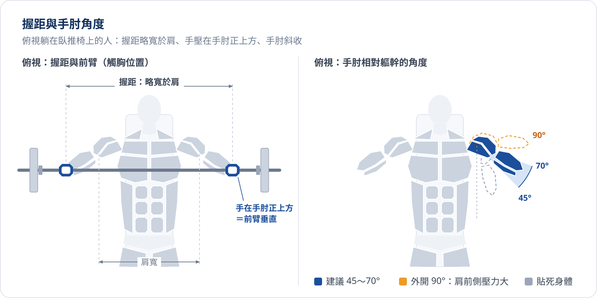

:badge[複合動作]{variant="info" icon="bolt"} :badge[自由重量樓層]{variant="neutral" icon="flag"} :badge[推日 A 第 1 個]{variant="warning" icon="star"} :badge[推日 B 第 2 個]{variant="neutral" outline}

槓鈴臥推是推日 A 的主項，整堂課狀態最好的時候先練它。它能用最大的重量訓練胸、前三角與三頭，所以也是推日力量進步最直接的指標。

## 目標肌群

| 類型 | 肌群 |
| :--- | :--- |
| :badge[主要]{variant="info" size="sm"} | 中下胸 |
| :badge[次要]{variant="neutral" size="sm"} | 上胸、前三角、三頭 |

每組正式組依 :ref[有效組數]{id="fit.effective-sets"} 計算：中下胸算 1 組，上胸、前三角、三頭各算 0.5 組。

## 動作拆解

{/* @ai-visualize
id: bench-press-motion
type: motion
status: generated
prompt: |
  核心洞察：臥推不是「把槓垂直推上去」，而是在穩定的上背與雙腳支撐下，讓槓鈴沿一條略斜的路徑在
  肩關節正上方（鎖定）與下胸（觸胸）之間來回，前臂在整個過程盡量保持垂直。
  互動：播放／暫停、速度（0.5x／1x）、可拖動的時間軸 scrubber；
  上方 stepper 分四個階段「出槓鎖定 → 下放（約 2 秒）→ 觸胸停頓 → 推起」，點階段跳到該時間點並顯示該階段的提示；
  切換「標示槓鈴路徑」顯示整個循環的槓鈴軌跡；
  切換三種常見錯誤對照：臀部離開臥推椅、槓鈴落點太高（落在鎖骨／頸部附近）、觸胸反彈，
  錯誤姿勢以紅色（警示色）疊在正確姿勢上，並顯示一句說明。
  圖形：側面示意（頭在左），依頭長 A 為比例單位的人體（頭 1A、胸腔 1.5A、骨盆 1A、上臂與前臂各約 1.5A、大腿 2A），身體為石板灰剪影、以細白線切出肌群區塊，頭手腳留白、側臉只畫輪廓，臥推椅、腳踩地、槓鈴與兩端槓片、掛鉤立柱。
  手臂用兩段連桿（上臂、前臂），手固定在槓上，以反向運動學依槓鈴位置計算手肘位置，動作要平順自然；
  旁邊即時顯示手肘角度、槓鈴高度，以及前臂是否垂直（垂直時標藍、偏離時標橘）。
  主要肌群（中下胸）與次要肌群（上胸、前三角、三頭）以橘／淺橘標示，推起階段顏色加深。
  資料/數值：只用筆記中的節奏與提示；不需要真實重量。
caption: 拖動時間軸或點選階段，看槓鈴路徑與前臂角度
*/}
import GeneratedFrame from '@/components/GeneratedFrame.astro'
import BenchPressMotion from '@notes/components/bench-press-motion'

<GeneratedFrame id="bench-press-motion" type="motion" prompt={"核心洞察：臥推不是「把槓垂直推上去」，而是在穩定的上背與雙腳支撐下，讓槓鈴沿一條略斜的路徑在\n肩關節正上方（鎖定）與下胸（觸胸）之間來回，前臂在整個過程盡量保持垂直。\n互動：播放／暫停、速度（0.5x／1x）、可拖動的時間軸 scrubber；\n上方 stepper 分四個階段「出槓鎖定 → 下放（約 2 秒）→ 觸胸停頓 → 推起」，點階段跳到該時間點並顯示該階段的提示；\n切換「標示槓鈴路徑」顯示整個循環的槓鈴軌跡；\n切換三種常見錯誤對照：臀部離開臥推椅、槓鈴落點太高（落在鎖骨／頸部附近）、觸胸反彈，\n錯誤姿勢以紅色（警示色）疊在正確姿勢上，並顯示一句說明。\n圖形：側面示意（頭在左），依頭長 A 為比例單位的人體（頭 1A、胸腔 1.5A、骨盆 1A、上臂與前臂各約 1.5A、大腿 2A），身體為石板灰剪影、以細白線切出肌群區塊，頭手腳留白、側臉只畫輪廓，臥推椅、腳踩地、槓鈴與兩端槓片、掛鉤立柱。\n手臂用兩段連桿（上臂、前臂），手固定在槓上，以反向運動學依槓鈴位置計算手肘位置，動作要平順自然；\n旁邊即時顯示手肘角度、槓鈴高度，以及前臂是否垂直（垂直時標藍、偏離時標橘）。\n主要肌群（中下胸）與次要肌群（上胸、前三角、三頭）以橘／淺橘標示，推起階段顏色加深。\n資料/數值：只用筆記中的節奏與提示；不需要真實重量。"} caption="拖動時間軸或點選階段，看槓鈴路徑與前臂角度">
  <BenchPressMotion client:visible />
</GeneratedFrame>

::::steps
:::step{title="躺好與五點接觸"}
眼睛在槓鈴正下方。頭、上背、臀部貼在椅上，雙腳踩穩地面，這五個接觸點整組都不離開。
:::
:::step{title="收肩胛、握槓"}
肩胛骨往後收、往下沉，胸口自然挺起形成小拱。握距略寬於肩，手腕打直，槓壓在掌根上方。
:::
:::step{title="出槓鎖定"}
把槓推離掛鉤，移到肩關節正上方鎖定，吸一口氣撐住軀幹。
:::
:::step{title="下放"}
約 2 秒控制下放，手肘往身體斜下方收，槓鈴落向下胸；前臂維持垂直。
:::
:::step{title="觸胸推起"}
輕觸胸口不反彈，腳往地面踩、把槓往斜後方推回肩關節正上方。
:::
::::

## 握距與手肘角度

- 握距：前臂在觸胸位置接近垂直的握距最穩，通常略寬於肩
- 手肘：不貼死身體也不外開成 90 度，常見建議落在 45～70 度之間；外開太多時肩關節前側壓力最大

:::warning{title="常見錯誤"}
- **臀部離椅**：推起時用腿把臀部頂離椅面，等於改變動作角度，重量看起來變輕
- **落點太高**：槓落在鎖骨或頸部附近，手肘被迫外開
- **觸胸反彈**：用胸口把槓彈起來，少了最吃力的那一段
:::

## 我的課表

| 日別 | 熱身組 | 正式組 | 休息 | 加重條件 |
| :--- | :--- | :--- | :--- | :--- |
| 推日 A（第 1 個） | 2 組：8 → 3 下，40kg → 50kg | 3 組 × 4～8 下，60kg | 3 分 | 3 組皆 6 下以上 → 62.5kg |
| 推日 B（第 2 個） | 1 組：5 下，40kg | 3 組 × 5～8 下，55kg | 3 分 | 3 組皆 8 下 → 57.5kg |

複合動作保留 1～2 下餘力；進步依 :ref{id="fit.double-progression"}，A、B 兩天各自記錄、各自加重。
長期目標是臥推 80～90kg × 5 下以上（見 :ref[力量參考目標]{id="fit.strength-goals"}）。

{/* @ai-visualize
id: bench-press-progression
type: motion
status: generated
prompt: |
  核心洞察：雙進度法下，加重與否只看「三組是否都達到門檻次數」，A、B 日門檻不同、各自進步。
  互動：A／B 日切換；三組正式組各有一個次數 stepper（＋／－），預設填入次數區間下限；
  即時判斷是否達到加重條件，達到時顯示下次重量，未達時顯示還差哪幾組幾下。
  圖形：左側是熱身到正式組的「重量階梯」長條（熱身組淺色、正式組藍色，標重量與次數），
  右側三組正式組以次數格子表示（區間內的格子、門檻線、實際完成的格子填色），
  門檻線在 A 日為 6 下、B 日為 8 下。
  資料/數值：A 日熱身 40kg×8、50kg×3，正式 60kg 3×4～8，門檻 3 組皆 6 下以上 → 62.5kg；
  B 日熱身 40kg×5，正式 55kg 3×5～8，門檻 3 組皆 8 下 → 57.5kg。
caption: 輸入每組做到的次數，看下次要不要加重
*/}
import BenchPressProgression from '@notes/components/bench-press-progression'

<GeneratedFrame id="bench-press-progression" type="motion" prompt={"核心洞察：雙進度法下，加重與否只看「三組是否都達到門檻次數」，A、B 日門檻不同、各自進步。\n互動：A／B 日切換；三組正式組各有一個次數 stepper（＋／－），預設填入次數區間下限；\n即時判斷是否達到加重條件，達到時顯示下次重量，未達時顯示還差哪幾組幾下。\n圖形：左側是熱身到正式組的「重量階梯」長條（熱身組淺色、正式組藍色，標重量與次數），\n右側三組正式組以次數格子表示（區間內的格子、門檻線、實際完成的格子填色），\n門檻線在 A 日為 6 下、B 日為 8 下。\n資料/數值：A 日熱身 40kg×8、50kg×3，正式 60kg 3×4～8，門檻 3 組皆 6 下以上 → 62.5kg；\nB 日熱身 40kg×5，正式 55kg 3×5～8，門檻 3 組皆 8 下 → 57.5kg。"} caption="輸入每組做到的次數，看下次要不要加重">
  <BenchPressProgression client:visible />
</GeneratedFrame>

完整推日流程見 [推日課表 A／B](../push-day.mdx)。
