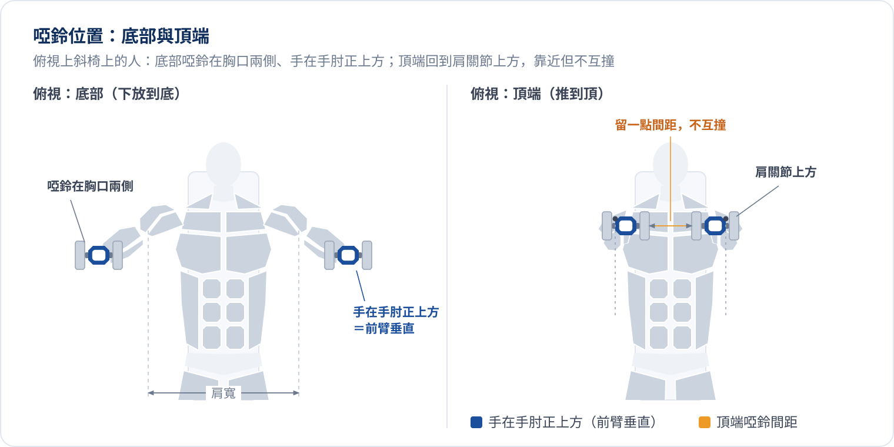

:badge[複合動作]{variant="info" icon="bolt"} :badge[自由重量樓層]{variant="neutral" icon="flag"} :badge[推日 B 第 1 個]{variant="warning" icon="star"} :badge[推日 A 第 2 個]{variant="neutral" outline}

上斜啞鈴臥推是推日 B 的主項，也是整份課表裡上胸量最高的動作。上胸偏平是目前的弱點之一（見 :ref[從夯到拉評價]{id="fit.physique-review"}），所以 B 日把它排在第一個，在狀態最好的時候練。

## 目標肌群

| 類型 | 肌群 |
| :--- | :--- |
| :badge[主要]{variant="info" size="sm"} | 上胸、前三角 |
| :badge[次要]{variant="neutral" size="sm"} | 中下胸、三頭 |

每組正式組依 :ref[有效組數]{id="fit.effective-sets"} 計算：上胸、前三角各算 1 組，中下胸、三頭各算 0.5 組。

## 動作拆解

{/* @ai-visualize
id: incline-db-press-motion
type: motion
status: generated
prompt: |
  核心洞察：椅背角度決定上胸與前三角的分工；30～45 度讓上胸吃到最多，再陡就慢慢變成肩推。
  互動：播放／暫停（預設不自動播放）、速度（0.5x／1x）、可拖動的時間軸 scrubber；
  上方 stepper 分四個階段「推到頂端 → 下放（約 2 秒）→ 底部停頓 → 推起」，點階段跳到該時間點並顯示提示；
  椅背角度切換 30°／45°／60°（60° 標為過陡），切換時軀幹傾角與啞鈴路徑跟著變，
  肌群顏色同步變化：角度越陡上胸越淡、前三角越深；
  切換「標示啞鈴路徑」；兩種常見錯誤對照：下放太淺（半程）、臀部離椅，錯誤姿勢以紅色（警示色）疊在正確姿勢上。
  圖形：側面示意（頭在上方左側），上斜臥推椅（椅背可調角度、座墊、椅腳），
  人物沿用槓鈴臥推動畫的頭長 A 比例與肌群區塊畫法（石板灰剪影、細白線分肌群、頭手腳留白、側臉只畫輪廓），
  手持啞鈴（端視：小圓槓片＋握把），手臂以反向運動學計算手肘，
  頂端啞鈴在肩關節正上方（垂直地面），底部啞鈴落在上胸兩側、前臂接近垂直。
  主要肌群（上胸、前三角）橘色、次要（中下胸、三頭）淺橘，推起階段顏色加深。
  旁邊即時顯示手肘角度、啞鈴高度、前臂是否垂直、目前椅背角度。
  資料/數值：只用筆記中的節奏與提示；不需要真實重量。
caption: 切換椅背角度，看上胸與前三角怎麼分工
*/}
import GeneratedFrame from '@/components/GeneratedFrame.astro'
import InclineDbPressMotion from '@notes/components/incline-db-press-motion'

<GeneratedFrame id="incline-db-press-motion" type="motion" prompt={"核心洞察：椅背角度決定上胸與前三角的分工；30～45 度讓上胸吃到最多，再陡就慢慢變成肩推。\n互動：播放／暫停（預設不自動播放）、速度（0.5x／1x）、可拖動的時間軸 scrubber；\n上方 stepper 分四個階段「推到頂端 → 下放（約 2 秒）→ 底部停頓 → 推起」，點階段跳到該時間點並顯示提示；\n椅背角度切換 30°／45°／60°（60° 標為過陡），切換時軀幹傾角與啞鈴路徑跟著變，\n肌群顏色同步變化：角度越陡上胸越淡、前三角越深；\n切換「標示啞鈴路徑」；兩種常見錯誤對照：下放太淺（半程）、臀部離椅，錯誤姿勢以紅色（警示色）疊在正確姿勢上。\n圖形：側面示意（頭在上方左側），上斜臥推椅（椅背可調角度、座墊、椅腳），\n人物沿用槓鈴臥推動畫的頭長 A 比例與肌群區塊畫法（石板灰剪影、細白線分肌群、頭手腳留白、側臉只畫輪廓），\n手持啞鈴（端視：小圓槓片＋握把），手臂以反向運動學計算手肘，\n頂端啞鈴在肩關節正上方（垂直地面），底部啞鈴落在上胸兩側、前臂接近垂直。\n主要肌群（上胸、前三角）橘色、次要（中下胸、三頭）淺橘，推起階段顏色加深。\n旁邊即時顯示手肘角度、啞鈴高度、前臂是否垂直、目前椅背角度。\n資料/數值：只用筆記中的節奏與提示；不需要真實重量。"} caption="切換椅背角度，看上胸與前三角怎麼分工">
  <InclineDbPressMotion client:visible />
</GeneratedFrame>

::::steps
:::step{title="調整椅背"}
椅背調到 30～45 度。坐好後臀部貼緊座墊與椅背交界，雙腳踩穩地面。
:::
:::step{title="上膝、躺下"}
啞鈴先立在大腿上，躺下時用膝蓋把啞鈴頂到胸口兩側，再推到肩關節正上方。
:::
:::step{title="收肩胛、鎖定"}
肩胛骨往後收、往下沉，上背貼緊椅背；啞鈴在肩關節正上方，掌心朝腳的方向。
:::
:::step{title="下放"}
約 2 秒控制下放，手肘往身體斜下方收，啞鈴落到上胸兩側；前臂維持垂直。
:::
:::step{title="推起"}
在底部短暫停頓，往上推回肩關節正上方；頂端兩顆啞鈴靠近但不互撞。
:::
::::

## 啞鈴位置與手肘角度

- 底部：啞鈴在胸口兩側（上斜時約在上胸高度）、手在手肘正上方，手肘與軀幹的角度和 [槓鈴臥推](./barbell-bench-press.mdx) 一樣，常見建議落在 45～70 度
- 頂端：兩顆啞鈴回到肩關節正上方，彼此靠近但不互撞，肩胛骨保持後收

:::warning{title="常見錯誤"}
- **椅背太陡**：超過 45 度後前三角接手越來越多，動作會慢慢變成肩推
- **下放太淺**：只做上半段，上胸最被拉長的那一段被省略
- **臀部離椅**：推起時臀部離開座墊，等於把角度改平，上斜的意義就不見了
:::

## 我的課表

| 日別 | 熱身組 | 正式組 | 休息 | 加重條件 |
| :--- | :--- | :--- | :--- | :--- |
| 推日 B（第 1 個） | 2 組：10 → 5 下，12.5kg → 17.5kg | 3 組 × 6～10 下，22.5kg | 2～3 分 | 3 組皆 10 下 → 25kg |
| 推日 A（第 2 個） | 1 組：6 下，15kg | 3 組 × 6～8 下，22.5kg | 2～3 分 | 3 組皆 8 下 → 25kg |

啞鈴重量皆為單邊。複合動作保留 1～2 下餘力；進步依 :ref{id="fit.double-progression"}，A、B 兩天各自記錄、各自加重。
長期目標是上斜啞鈴 30kg × 8 下（見 :ref[力量參考目標]{id="fit.strength-goals"}）。

{/* @ai-visualize
id: incline-db-press-progression
type: motion
status: generated
prompt: |
  核心洞察：雙進度法下，加重與否只看「三組是否都達到門檻次數」，A、B 日門檻不同、各自進步。
  互動：A／B 日切換（B 日在前，因為這是 B 日主項）；三組正式組各有一個次數 stepper（＋／－），預設填入次數區間下限；
  即時判斷是否達到加重條件，達到時顯示下次重量，未達時顯示還差哪幾組幾下。
  圖形：左側是熱身到正式組的「重量階梯」長條（熱身組淺色、正式組藍色，標單邊重量與次數），
  右側三組正式組以次數格子表示（區間內的格子、門檻線、實際完成的格子填色），
  門檻線在 B 日為 10 下、A 日為 8 下。
  資料/數值：B 日熱身 12.5kg×10、17.5kg×5，正式 22.5kg 3×6～10，門檻 3 組皆 10 下 → 25kg；
  A 日熱身 15kg×6，正式 22.5kg 3×6～8，門檻 3 組皆 8 下 → 25kg。重量皆為單邊。
caption: 輸入每組做到的次數，看下次要不要加重
*/}
import InclineDbPressProgression from '@notes/components/incline-db-press-progression'

<GeneratedFrame id="incline-db-press-progression" type="motion" prompt={"核心洞察：雙進度法下，加重與否只看「三組是否都達到門檻次數」，A、B 日門檻不同、各自進步。\n互動：A／B 日切換（B 日在前，因為這是 B 日主項）；三組正式組各有一個次數 stepper（＋／－），預設填入次數區間下限；\n即時判斷是否達到加重條件，達到時顯示下次重量，未達時顯示還差哪幾組幾下。\n圖形：左側是熱身到正式組的「重量階梯」長條（熱身組淺色、正式組藍色，標單邊重量與次數），\n右側三組正式組以次數格子表示（區間內的格子、門檻線、實際完成的格子填色），\n門檻線在 B 日為 10 下、A 日為 8 下。\n資料/數值：B 日熱身 12.5kg×10、17.5kg×5，正式 22.5kg 3×6～10，門檻 3 組皆 10 下 → 25kg；\nA 日熱身 15kg×6，正式 22.5kg 3×6～8，門檻 3 組皆 8 下 → 25kg。重量皆為單邊。"} caption="輸入每組做到的次數，看下次要不要加重">
  <InclineDbPressProgression client:visible />
</GeneratedFrame>

完整推日流程見 [推日課表 A／B](../push-day.mdx)。
